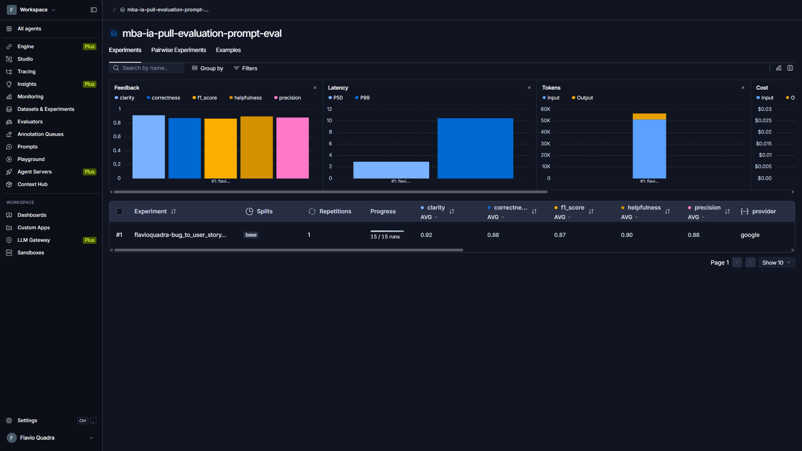
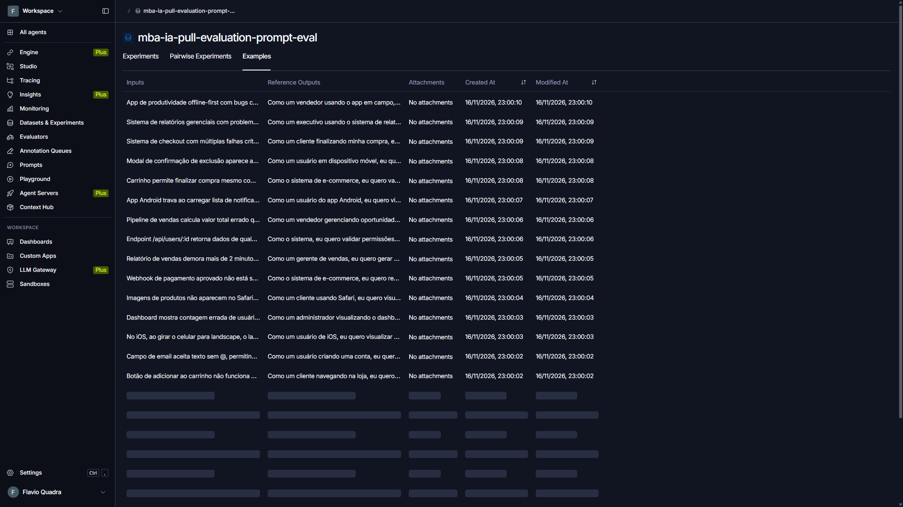

# Pull, Otimização e Avaliação de Prompts com LangChain e LangSmith

Este projeto puxa um prompt fraco do LangSmith Prompt Hub, reescreve a conversão de bug report em User Story e publica a versão otimizada para avaliação. A meta é atingir pelo menos 0,8 em Helpfulness, Correctness, F1-Score, Clarity e Precision, com todas as métricas acima do corte ao mesmo tempo.

## Técnicas Aplicadas (Fase 2)

O prompt v1 pede uma user story em uma frase genérica, repete `{bug_report}` no system e no user e não define persona, formato, critério de aceite nem o que fazer com relato incompleto. A v2 separa a instrução estável do dado variável e aplica quatro técnicas.

### Role Prompting

O system prompt abre com uma persona fixa: um Product Manager sênior que escreve a história do ponto de vista de quem sofre o bug. A persona de saída também é obrigatória e específica. Cliente, administrador, gerente, usuário de uma plataforma ou o próprio sistema entram no "Como um" conforme o ator do relato. "Como um usuário", sozinho, fica proibido.

Isso reduz história genérica. Um botão de carrinho passa a ter cliente e benefício de compra. Um webhook sem operador humano passa a ter o sistema como ator, porque a garantia é do produto.

### Few-shot Learning

Há três pares de Entrada e Saída, um para cada faixa de complexidade do dataset: sintoma único, falha com log e endpoint, e relato com várias falhas mais impacto de negócio. Os exemplos são originais. Eles mostram o formato, a densidade e o que não entra na resposta. O modelo copia o padrão em vez de improvisar a estrutura a cada bug.

### Chain of Thought

A instrução manda extrair fatos, classificar complexidade, escolher persona, escolher esqueleto, redigir critérios e só então apagar o que não está no relato. Esse passo a passo fica interno. A resposta publicada não contém o raciocínio, porque texto de análise fora da User Story seria informação a mais na comparação com a referência e derrubaria Precision e Clarity.

### Skeleton of Thought

A saída tem três esqueletos fechados:

- simples: frase "Como um / eu quero / para que" e critérios Dado que, Quando, Então, E
- média: o mesmo bloco mais Contexto Técnico, e uma seção extra só se o relato tiver segurança, prevenção ou cálculo
- complexa: blocos `=== USER STORY PRINCIPAL ===`, critérios nomeados, critérios técnicos, contexto do bug e tasks

O esqueleto acompanha a complexidade. Bug simples não ganha tasks. Bug com três falhas não fica em cinco bullets.

### Regras e casos de borda

O prompt exige Markdown, as três partes da User Story e critérios testáveis. Números, rotas, status HTTP e mensagens são copiados literalmente. O que não veio no relato fica como "não informado", em vez de virar causa inventada. Relato vago, falhas múltiplas, números contraditórios, segurança, performance, cálculo e concorrência têm regra própria.

## Comparação entre v1 e v2

| Aspecto | v1 | v2 |
| --- | --- | --- |
| Persona de quem escreve | "assistente" genérico | Product Manager sênior |
| Persona da história | não definida | papel e contexto obrigatórios |
| Formato | "crie uma user story" | Markdown com esqueleto por complexidade |
| Exemplos | nenhum | três pares Entrada / Saída |
| Critérios de aceite | não pedidos | Given-When-Then obrigatório |
| Fatos técnicos | sem regra | copiar literalmente e não inventar causa |
| Casos de borda | nenhum | relato vago, múltiplas falhas, segurança, performance e cálculo |
| Variável | `{bug_report}` repetida no system e no user | system estável e `{bug_report}` só no user |

A v1 deixa o modelo decidir formato e profundidade. A v2 amarra a resposta no mesmo tipo de texto usado nas referências do dataset: história positiva, critérios observáveis e contexto técnico apenas quando o relato traz evidência.

## Resultados Finais

A avaliação oficial roda no LangSmith com `python src/evaluate.py`, contra o dataset de 15 bugs. Helpfulness é a média de Clarity e Precision. Correctness é a média de F1-Score e Precision. As cinco notas precisam ficar em 0,8 ou mais.

A execução oficial, com `gemini-3.5-flash-lite` nos dois papéis, aprovou `flavioquadra/bug_to_user_story_v2`:

| Métrica | Nota |
| --- | ---: |
| Helpfulness | 0,90 |
| Correctness | 0,88 |
| F1-Score | 0,87 |
| Clarity | 0,92 |
| Precision | 0,88 |
| Média | 0,89 |

Experimento: https://smith.langchain.com/o/5f6160b4-730a-463a-ba25-814f6d737e14/datasets/0c52fd4f-d983-4a76-ad0b-7dfad18aa55f/compare?selectedSessions=c96c3361-62b0-46cf-a050-aa8a53646c9c

Dataset público, com os experimentos: https://smith.langchain.com/public/2aee30b2-14ac-4d83-a4c3-ea584ab942c4/d

Prompt publicado: https://smith.langchain.com/hub/flavioquadra/bug_to_user_story_v2

Antes dessa rodada, uma amostra local com `gemini-3.5-flash` tinha ficado assim:

| Bug | F1 | Clarity | Precision | Helpfulness | Correctness |
| --- | ---: | ---: | ---: | ---: | ---: |
| Carrinho, simples | 1,00 | 1,00 | 1,00 | 1,00 | 1,00 |
| Dashboard, simples | 0,92 | 0,97 | 1,00 | 0,99 | 0,96 |
| Desconto do pipeline, médio | 0,97 | 1,00 | 1,00 | 1,00 | 0,99 |
| Checkout, complexo | 0,88 | 1,00 | 1,00 | 1,00 | 0,94 |

A amostra local acima foi só uma checagem antes da rodada oficial. O checkout complexo é o caso mais apertado no F1, porque a referência traz controles que o relato não nomeia (DOMPurify, circuit breaker, SELECT FOR UPDATE, idempotency key). A v2 manda incluir esses controles quando a causa já está no relato.

No dashboard público, as cinco médias ficam acima de 0,8 e o dataset mostra os 15 exemplos.





## Como Executar

### Pré-requisitos

- Python 3.10 ou superior
- Conta no LangSmith e uma API key
- Handle público do LangSmith Hub em `USERNAME_LANGSMITH_HUB`
- Chave de um provedor de LLM. Este projeto está preparado para Google Gemini (`LLM_PROVIDER=google`) ou OpenAI (`LLM_PROVIDER=openai`)
- Modelos atuais preenchidos em `LLM_MODEL` e `EVAL_MODEL`. Eles não são fixos: confira a documentação do provedor, porque nomes são descontinuados

Handle do Hub: em LangSmith, abra Prompts, use Make Public uma vez e confirme o handle. Esse valor é definitivo e é o prefixo de `{handle}/bug_to_user_story_v2`.

### Ambiente

No Windows, na raiz do projeto:

```powershell
python -m venv venv
.\venv\Scripts\Activate.ps1
pip install -r requirements.txt
Copy-Item .env.example .env
```

Preencha o `.env`. Não commite esse arquivo.

Variáveis usadas:

- `LANGSMITH_API_KEY`, `LANGSMITH_PROJECT`, `USERNAME_LANGSMITH_HUB`
- `LLM_PROVIDER` com `google` ou `openai`
- `GOOGLE_API_KEY` ou `OPENAI_API_KEY`, conforme o provedor
- `LLM_MODEL` para gerar a User Story e `EVAL_MODEL` para julgar. Prefira modelos que aceitem temperature 0

Neste ambiente, `gemini-2.5-flash` não está mais disponível para usuários novos e `gemini-3.8-flash` estourou o prazo da API. `gemini-3.5-flash` responde bem e aceita temperature 0, mas no plano gratuito o alias cai em `gemini-3.6-flash` com teto de 20 pedidos por dia. A avaliação oficial faz cerca de 60 chamadas (15 bugs, uma geração e três juízes cada), então o `.env` local usa `gemini-3.5-flash-lite` nos dois papéis. Uma amostra local com o modelo maior, antes da cota acabar, ficou acima de 0,8 nos bugs simples, médios e no checkout complexo.

### Fases

1. Puxar o prompt semente `leonanluppi/bug_to_user_story_v1` para `prompts/bug_to_user_story_v1.yml`:

```powershell
python src/pull_prompts.py
```

O pull usa `dangerously_pull_public_prompt=True` porque o identificador tem dono explícito.

2. A versão otimizada já está em `prompts/bug_to_user_story_v2.yml`. Ajuste esse arquivo se alguma métrica voltar abaixo de 0,8. Não altere `datasets/bug_to_user_story.jsonl`.

3. Publicar o prompt público `{USERNAME_LANGSMITH_HUB}/bug_to_user_story_v2`, com descrição e tags:

```powershell
python src/push_prompts.py
```

4. Avaliar. Cada execução cria um experimento e grava as cinco notas como feedback:

```powershell
python src/evaluate.py
```

5. Validar a estrutura do prompt sem chamar LLM:

```powershell
pytest tests/test_prompts.py
```

Os seis testes conferem system prompt, persona de Product Manager, formato de User Story, exemplos few-shot, ausência de TODO e pelo menos duas técnicas nos metadados.

### Iteração

Se o status vier reprovado, o relatório lista a métrica abaixo de 0,8. Clarity baixa pede esqueleto mais limpo. Precision baixa pede menos texto inventado. F1 baixo pede mais fatos do relato dentro dos critérios. Edite o YAML, rode o push de novo e avalie outra vez. Três a cinco rodadas são o esperado até as cinco métricas passarem juntas.
